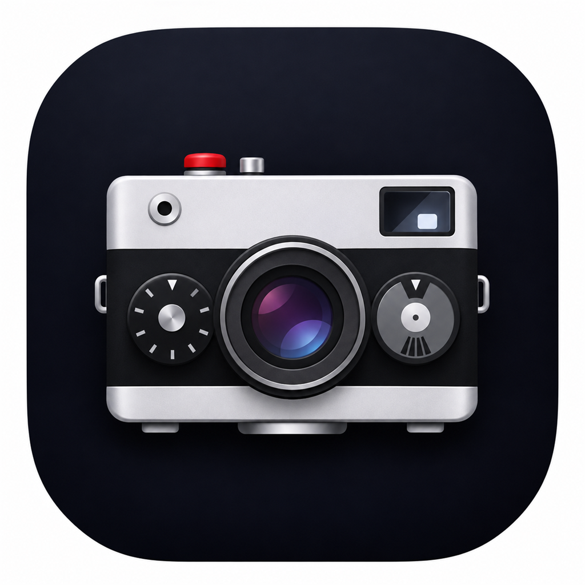

# PocketFilm iOS

<p align="center">
  
</p>

PocketFilm 是基于 SpektraLab 的非官方 iPhone RAW 相机。你可以拍摄 Apple ProRAW 或 Bayer RAW，也可以从相册或「文件」导入图像。应用在设备上显影，保留原片，并生成可保存或分享的 JPG、HEIF 成片。内置 **20 种 Spektrafilm 预设**和 **47 种 Fotufilm 调色配方**。

[上手指南](#上手指南) · [功能与参数](#功能与参数) · [Fotufilm 调色配方](#fotufilm-调色配方) · [构建和安装](#构建和安装) · [项目架构](#项目架构) · [上游与许可](#上游与许可)

当前源码版本为 **0.3.0（build 3）**，最低部署目标为 **iOS 17**，构建需要 **Xcode 27 和 iOS 27 SDK**。可变光圈需要 iOS 27 或更新版本，以及支持该能力的镜头和拍摄配置。

## 上手指南

### 拍一张 RAW

1. 打开 PocketFilm，允许访问相机。等取景画面和快门可用后，从顶部参数栏选择「镜头」、「RAW 格式」和「胶片」。默认胶片是 Spektrafilm 的 **Kodak Portra 400**。展开「Fotufilm · 调色配方」可选用另一组配方。
2. 在取景画面上点一下，选择自动对焦区域。需要辅助线时，打开「构图」，选择九宫格、方形或 16:9。
3. 如需调整胶片曝光、色温、颗粒或光晕，打开「显影」。如需提前选定成片格式，点操作栏里显示 **JPG** 或 **HEIF** 的导出按钮。
4. 按圆形快门。应用先把 RAW 写入「本地底片」，再按当前设置显影。显影成功后自动打开「胶片成片」。

### 从相册或「文件」导入

| 入口 | 可以选择的内容 |
| --- | --- |
| 右上角导入按钮 → **从相册选择** | 普通照片或系统照片选择器能够提供的 RAW。每次选一张，可在导入前先选好胶片和显影设置。 |
| 右上角导入按钮 → **从文件导入 RAW** | 「文件」中由 iOS 识别并能解码的 RAW，例如兼容的 DNG。 |

导入后，应用把系统提供的文件复制到本地底片库，再开始显影。相册入口只读取你选中的项目。若相册没有提供 RAW 原片，将原始 RAW 文件放进「文件」，再走 RAW 导入入口。普通照片沿用输入图像已有的白平衡，关闭「自动色温」后可手动调整。

### 修改成片、保存和分享

1. 在「胶片成片」页可切换胶片，或调整色温、颗粒、光晕、片边和「成片导出」设置。颗粒、光晕和片边适用于 Spektrafilm 预设。
2. 点 **应用设置并预览成片**，从本地原片重新显影。页面显示当前成片及其像素尺寸和处理耗时。
3. 点 **保存 RAW 与成片到相册**，把原始 RAW 与成片保存成两个独立的相册项目。普通照片导入后，按钮为 **保存成片到相册**，只新增显影后的照片。首次保存时按 iOS 提示授予相册添加权限。
4. 需要保存到「文件」或发给别人时，使用分享按钮。成片与当前设置一致时，可分享原片、成片和 `recipe.json`。设置有变更时，分享入口只提供原片。重新显影后即可分享新成片。

保存到相册会先应用尚未显影的设置。若显影或相册写入失败，已经存入底片库的原片仍可打开、重试或分享。刚拍摄或导入的项目会先进入应用内底片库，系统相册由成片页的保存按钮写入。

### 管理本地底片

- 从相机操作栏点 **底片**，按时间从新到旧浏览。拍摄条目用快门时间，导入条目用导入时间，显示格式为 `yyyy-MM-dd HH:mm:ss`。
- 列表缩略图优先使用成片，缓存长边最多 384 像素。只有原片时，普通照片可生成缩略图，RAW 则尝试读取内嵌预览。没有可用预览时显示占位图。
- 点开底片会恢复保存的显影和导出参数。修改后可以重新显影，原片保留。“原片已保留，可重新显影”表示该项目当前没有成片。
- 左滑、长按，或进入 **编辑** 模式可以删除本地底片。确认后，该条目的原片、成片、参数和缩略图会一并删除，**无法撤销**。系统相册中的副本独立保留。
- 本地文件存放在应用文档目录的 `Captures/` 中。新目录和文件名包含年月日、时分秒和毫秒，同名会追加序号。每条记录可包含 `*_RAW.dng` 或 `*_Photo.*`、`*_Film.jpg` 或 `*_Film.heic`、`recipe.json`、`capture.json` 和 `thumbnail.jpg`。旧版 UUID 目录、`source.dng` 和 `film.jpg` 仍可读取。应用开启了 iOS 文件共享。

## 功能与参数

### 相机与取景

| 功能 | 当前实现 |
| --- | --- |
| 原生取景 | 使用 iOS 相机预览层直接显示取景画面。胶片色彩、颗粒、光晕和片边在拍后显影时生成。 |
| 后置镜头 | 从系统发现可用的超广角、广角 1× 和长焦，并通过镜头菜单切换。 |
| RAW 格式 | 可选 Apple ProRAW 或 Bayer RAW。ProRAW 使用苹果的计算摄影 RAW 流程，Bayer RAW 保留感光阵列的马赛克采样。镜头切换后会重新查询可拍格式，只有一种可用时会选用该格式。 |
| 点击对焦 | 点取景画面选择焦点。黄色框表示选点位置，合焦状态由相机控制。固定焦点或不支持选点的镜头会给出提示。 |
| 横竖屏 | 支持竖屏和左右横屏，横屏时快门操作栏在右侧。按快门时读取设备姿态并设置照片方向，平放或方向未知时使用上一次有效方向。 |
| 构图辅助 | 关闭、九宫格、方形、16:9，默认九宫格。这些线只辅助取景。成片的胶片画幅裁剪由片边设置单独控制。 |
| 物理光圈 | 顶部栏显示当前镜头的光圈。运行 iOS 27 或更新版本且镜头支持时，可选「自动」或系统报告的物理光圈档位。光圈优先时，快门和 ISO 仍由系统自动控制。固定光圈镜头会显示对应提示。 |

### 胶片显影

| 参数 | 范围或行为 | 默认 |
| --- | --- | --- |
| 胶片曝光 | −3 至 +3 EV，步长 0.1 EV。影响显影阶段的亮度。 | 0 EV |
| 自动色温 | RAW 沿用拍摄白平衡，普通照片沿用输入图像的白平衡。 | 开启 |
| 手动色温 | 2000–12000 K，步长 100 K。关闭「自动色温」后可调。 | 5500 K |
| 颗粒 | 0–2，步长 0.05。设为 0 时关闭。 | 1 |
| 光晕 | 0–4，步长 0.05。设为 0 时关闭。 | 1 |
| 相纸 | 随胶片配置自动匹配。 | 随胶片 |

Spektrafilm 分组有 **20 种胶片配置**，包括 16 种彩色配置和 4 种黑白配置。Portra 800 的两种增感配置各计一种。

| 类别 | 胶片 |
| --- | --- |
| Kodak 彩色负片 | Ektar 100、Gold 200、Portra 160、Portra 400、Portra 800、Portra 800 (Push 1)、Portra 800 (Push 2)、Ultramax 400 |
| Kodak 电影胶片及相关配置 | Verita 200D、Vision3 50D、Vision3 200T、Vision3 250D、Vision3 500T |
| Fujifilm 彩色负片 | C200、Pro 400H、X-Tra 400 |
| 黑白胶片 | Fujifilm Neopan 100 Acros II、Ilford HP5 Plus 400、Kodak T-Max 100、Kodak Tri-X 400 |

### Fotufilm 调色配方

胶片菜单还提供 **47 种 Fotufilm 调色配方**，例如 Kodachrome 64、Ektachrome E100、CineStill 800T、Harman Phoenix 200、FP4 Plus 和 LomoChrome Purple。拍摄或导入前，从顶部「胶片」进入 Fotufilm 分组。拍摄或导入后，从「胶片成片」页的「胶片」菜单选择配方，再点「应用设置并预览成片」。两组中同名的胶卷拥有各自的配方。

Fotufilm 配方通过离线 3D 调色表重现固定显影条件下的颜色与反差，支持显影曝光、色温、JPG／HEIF、色域、尺寸和压缩质量。颗粒、光晕和片边在 Spektrafilm 预设中使用。调色表随应用打包，可离线使用。 [移植说明与配方许可](ios/Fotufilm/README.md)

### 胶片片边

拍摄前，在 **构图 → 添加胶片片边** 开启。拍摄或导入完成后，也可在成片页的 **片边** 区域启用或更换。

| 选项 | 可选内容 |
| --- | --- |
| 片边类型 | 135 标准、135 半格、135 XPan、120 6×4.5、120 6×6、120 6×7、120 6×8、120 6×9、120 6×12、120 6×17 |
| 扫描样式 | 片条扫描、扩孔片夹 |
| 齿孔 | 支持齿孔的 135 片条可选白色或黑色。120 片边没有齿孔。 |
| 帧号 | 0–99，0 为自动。 |
| 边缘灰雾和片轴漏光 | 都可调 0–4，步长 0.05。灰雾默认 1，漏光默认 0。 |

片边由 Spektrafilm 引擎生成，并根据胶片配置绘制边缘标记。同一张底片重新显影会沿用原来的片边随机参数。开启片边后，成片按选定片窗比例居中裁剪，**画面区域**长边最多 2048 像素，外侧片边会增加文件的最终尺寸。要恢复完整构图，可以关闭片边后从原片重新显影。

### 成片导出

| 设置 | 选项和默认值 |
| --- | --- |
| 文件格式 | **JPG**（`.jpg`，默认）或 **HEIF**（`.heic`）。 |
| 色域 | **sRGB**（默认）、**Adobe RGB (1998)**、**Display P3** 或 **DCI-P3**。Display P3 和 DCI-P3 是两个独立配置。 |
| 压缩质量 | 1–100，步长 1，默认 100。兼容旧版底片参数时采用原来的 JPG、sRGB、质量 95。 |
| 画面长边上限 | 无片边时选 2048 或 4032 像素，默认 4032。开启片边后画面区域上限为 2048，另加边缘像素。 |

压缩质量是编码器参数，100 仍采用有损编码。选择的长边是上限，小图保持原尺寸或按片窗裁剪。相机 RAW 的尺寸由当前镜头与拍摄配置决定。若当前系统无法编码某个格式和色域组合，应用会报错并保留原片，可更换导出设置后重试。

## 构建和安装

### Windows 或没有 Mac 时

1. **下载已有构建**。登录 GitHub，进入 [Actions 构建列表](https://github.com/hachirokulover/PocketFilm-iOS/actions/workflows/ios-pocketfilm.yml)，打开对应源码版本的运行详情，在 **Artifacts** 下载 `PocketFilm-iPhone-<运行编号>`。产物保留 **7 天**。解压下载的 ZIP，取出 **`PocketFilm-unsigned.ipa`**。
2. **需要重新编译时**。拥有仓库写入权限即可在自己的仓库运行，也可以先点 **Fork** 创建副本。如果副本的 **Actions** 页提示工作流未启用，先按页面提示启用。确保 [工作流文件](.github/workflows/ios-pocketfilm.yml) 已在默认分支上。
3. 在 **Actions → Build PocketFilm for iPhone → Run workflow** 选择要编译的分支，通常是 `main`。使用 `xcode-27`，保留 `run_tests` 勾选以运行模拟器测试，然后点 **Run workflow**。运行结束后从该次运行的 **Artifacts** 下载并解压。 [GitHub 手动运行指南](https://docs.github.com/en/actions/how-tos/manage-workflow-runs/manually-run-a-workflow) · [下载产物指南](https://docs.github.com/en/actions/how-tos/manage-workflow-runs/download-workflow-artifacts)
4. **在 Windows 本机签名并安装**。用 USB 连接并解锁 iPhone，按提示信任电脑。按工具官网准备 Windows 依赖并登录你自己的 Apple 账户。使用 AltStore Classic 时，让 Windows 上的 AltServer 保持运行，在手机端 **My Apps → +** 选中解压出的 IPA。使用 Sideloadly 时，在 Windows 上选择设备和 IPA，再点击安装。根据 iOS 提示启用开发者模式、信任开发者。免费个人签名通常需要在 7 天内刷新。 [AltStore Classic Windows 安装指南](https://faq.altstore.io/altstore-classic/how-to-install-altstore-windows) · [Sideloadly](https://sideloadly.io/) · [Apple 个人团队说明](https://developer.apple.com/help/account/basics/about-your-developer-account)

工作流只编译和打包，签名在本机完成。GitHub 的 **Code → Download ZIP** 下载的是源码。用于签名的文件是 **Actions 产物里的 `PocketFilm-unsigned.ipa`**。如果 AltStore 提示格式无效，先确认选的是已解压出的 IPA，重新下载当前设备版产物再试。 [AltStore 错误代码](https://faq.altstore.io/altstore-classic/error-codes)

云端运行失败时，到作业详情展开第一个失败的步骤。设备编译或打包错误看 `device-build.log`，模拟器测试错误看 `simulator-tests.log` 或 `PocketFilmTests.xcresult`（测试步骤创建后才会有这些文件）。设备 IPA 可以在模拟器测试前生成，须分别查看两个步骤的状态。

### 在 Mac 上使用 Xcode

准备带 iOS 27 SDK 的 Xcode 27、Metal 工具链、Python 3 和通过 rustup 安装的 Rust stable。在仓库根目录执行：

```bash
rustup toolchain install stable --profile minimal
rustup target add --toolchain stable aarch64-apple-ios aarch64-apple-ios-sim x86_64-apple-ios
cargo +stable test --locked --manifest-path ios/RustCore/Cargo.toml --target-dir ios/build/rust-host
```

打开 [PocketFilm.xcodeproj](ios/PocketFilm.xcodeproj)，选择 **PocketFilm** scheme。安装到 iPhone 时，在 **Signing & Capabilities** 选择自己的 Team，连接手机后选它作为运行设备，再点 **Run**。签名冲突时可为自己的构建设置唯一的 Bundle Identifier。

从仓库根目录可运行以下命令检查设备端编译：

```bash
bash ios/Tools/verify-on-mac.sh
```

运行模拟器测试时，先用 `xcrun simctl list devices available` 找到已安装的 iPhone 模拟器，再把对应目标传给脚本：

```bash
bash ios/Tools/verify-on-mac.sh 'platform=iOS Simulator,id=替换为模拟器的UDID'
```

### 构建记录与真机截图

提交 `f7d3398` 的 [GitHub Actions 第 7 次运行](https://github.com/hachirokulover/PocketFilm-iOS/actions/runs/45399193063) 已通过 Rust 主机测试并生成未签名设备 IPA。该次运行跳过了模拟器测试。项目此前记录曾在 iPhone 18 Pro（iOS 27.2）上验证镜头切换与可变光圈。下图为早期版本的实机截图。

<p align="center">
  
</p>

## 项目架构

| 目录 | 负责内容 |
| --- | --- |
| [`ios/PocketFilm/`](ios/PocketFilm/) | SwiftUI 界面、AVFoundation 拍摄和取景、Core Image RAW 解码与成片编码、系统照片选择器和本地底片管理。 |
| [`ios/RustCore/`](ios/RustCore/) | 将 Spektrafilm 胶片、曝光、颗粒、光晕、片边和导出设置转换为引擎参数，计算缩放尺寸和压缩质量，管理渲染会话、结果纹理和错误。Xcode 将 Rust 核心编译为静态库。 |
| [`engine/`](engine/) | SpektraLab 的 C++／Metal 光谱引擎和胶片资源，执行实际的颜色、颗粒、光晕和片边像素运算。 |
| [`ios/Fotufilm/`](ios/Fotufilm/) | 47 份从 Fotufilm 渲染生成的 3D 调色表和配方索引，由 iOS 的 Metal 渲染路径读取。 |
| [`ios/Tools/`](ios/Tools/) 与 [GitHub Actions 工作流](.github/workflows/ios-pocketfilm.yml) | 项目生成与校验、iOS Metal 编译、Rust 编译、测试和 IPA 打包。 |

拍摄或导入后，系统框架负责解码。Spektrafilm 通过 Rust 调度 C++／Metal 光谱引擎。Fotufilm 通过 Metal 应用 3D 调色表。两组共用 Core Image 编码、本地底片库和相册保存流程。

## 上游与许可

- PocketFilm 是 Hanze Qiu（JamesQiu2005）的 SpektraLab 的非官方 iOS 移植。上游源码基线为 `02d82b56cf65f0f8e802a708612edc4e9a4790af`。 [SpektraLab 上游提交](https://github.com/JamesQiu2005/SpektraLab/tree/02d82b56cf65f0f8e802a708612edc4e9a4790af)
- 光谱胶片模型与数据来自 Andrea Volpato 的 spektrafilm。原始 profiles、LUT 与直接衍生数据适用 **CC BY-SA 4.0**。 [spektrafilm](https://github.com/andreavolpato/spektrafilm) · [数据许可与署名](license/SPEKTRAFILM_LICENSE.txt)
- Fotufilm 调色表源自 Fotufilm（© 2026 MUAStudio Inc.）的胶片配方，转换后的数据按 **CC BY-SA 4.0** 提供。 [来源与改动](ios/Fotufilm/README.md) · [配方署名](license/Fotufilm-FILM-PROFILES.txt) · [完整许可](license/Fotufilm-CC-BY-SA-4.0.txt)
- 项目代码采用 **GPL-3.0-or-later**。第三方依赖及 SpektraLab 新增配置保留各自的许可和来源声明。应用右上角「关于」也可查看随程序分发的许可。 [代码许可](license/LICENSE) · [Metal-cpp 许可](engine/third_party/metal-cpp/LICENSE.txt) · [新增胶片配置声明](engine/resources_product/NOTICE.md)
